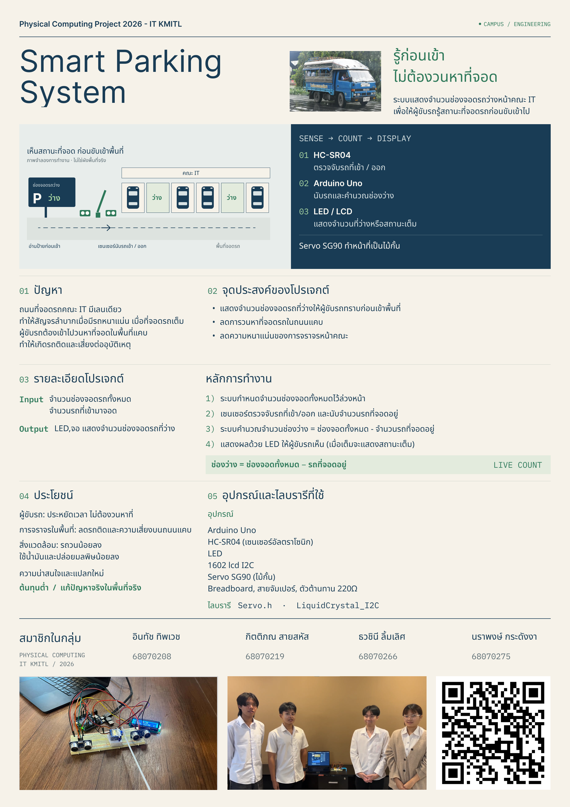

# 🚗 Smart Parking System

**Physical Computing Project 2026 — IT KMITL**

ระบบแสดงจำนวนช่องจอดรถว่างหน้าคณะ IT เพื่อให้ผู้ขับรถรู้สถานะที่จอดรถ **ก่อนขับเข้าไป**

## 📄 Poster


## 🔗 Link
- **คลิปนำเสนอโปรเจกต์:** [Click Me!](https://youtu.be/JWfumg-1lxc)
- **Github.IO:** [Click Me!](https://zenozense.github.io/Parking-Lot-Controller/)
---

## 👥 สมาชิกในกลุ่ม

| ชื่อ | รหัสนักศึกษา |
|---|---|
| อินทัช ทิพเวช | 68070208 |
| กิตติภณ สายสหัส | 68070219 |
| ธวชินี ลิ้มเลิศ | 68070266 |
| นราพงษ์ กระดังงา | 68070275 |

---

## ❗ ปัญหา

ถนนที่จอดรถคณะ IT แคบ ทำให้สัญจรลำบากเมื่อมีรถหนาแน่น
เมื่อที่จอดรถเต็ม ผู้ขับรถต้องเข้าไปวนหาที่จอดในพื้นที่แคบ ทำให้เกิดรถติดและเสี่ยงต่ออุบัติเหตุ

## 🎯 จุดประสงค์ของโปรเจกต์

1. แสดงจำนวนช่องจอดรถที่ว่างให้ผู้ขับรถทราบก่อนเข้าพื้นที่
2. ลดการวนหาที่จอดรถในถนนแคบ
3. ลดความหนาแน่นของการจราจรหน้าคณะ

## 🙋 ผู้ที่ได้รับประโยชน์

ผู้ที่มาจอดรถที่คณะ IT

---

## ⚙️ รายละเอียดโปรเจกต์

| | รายละเอียด |
|---|---|
| **Input** | • จำนวนช่องจอดรถทั้งหมด<br>• จำนวนรถที่เข้ามาจอด |
| **Output** | • LED และจอ LCD แสดงจำนวนช่องจอดรถที่ว่าง |

### หลักการทำงาน

1. ระบบกำหนดจำนวนช่องจอดทั้งหมดไว้ล่วงหน้า
2. เซนเซอร์ตรวจจับรถที่เข้า/ออก และนับจำนวนรถที่จอดอยู่
3. ระบบคำนวณจำนวนช่องว่าง

   ```
   ช่องว่าง = ช่องจอดทั้งหมด − จำนวนรถที่จอดอยู่
   ```

4. แสดงผลด้วย LED ให้ผู้ขับรถเห็น (เมื่อเต็มจะแสดงสถานะ **เต็ม**)

### ความน่าสนใจและแปลกใหม่

- ต้นทุนต่ำ
- แก้ปัญหาจริงในพื้นที่จริง

### ประโยชน์

| ผู้ที่ได้รับประโยชน์ | ประโยชน์ |
|---|---|
| ผู้ขับรถ | ประหยัดเวลา ไม่ต้องวนหาที่ |
| การจราจรในพื้นที่ | ลดรถติดและความเสี่ยงบนถนนแคบ |
| สิ่งแวดล้อม | รถวนน้อยลง ใช้น้ำมันและปล่อยมลพิษน้อยลง |

---

## 🧰 อุปกรณ์และไลบรารีที่ใช้

### อุปกรณ์

- Arduino Uno
- HC-SR04 (เซนเซอร์อัลตราโซนิก)
- LED
- 1602 LCD I2C
- Servo SG90 (ไม้กั้น)
- Breadboard, สายจัมเปอร์, ตัวต้านทาน 220Ω

### ไลบรารี

- `Servo.h`
- `LiquidCrystal_I2C`
